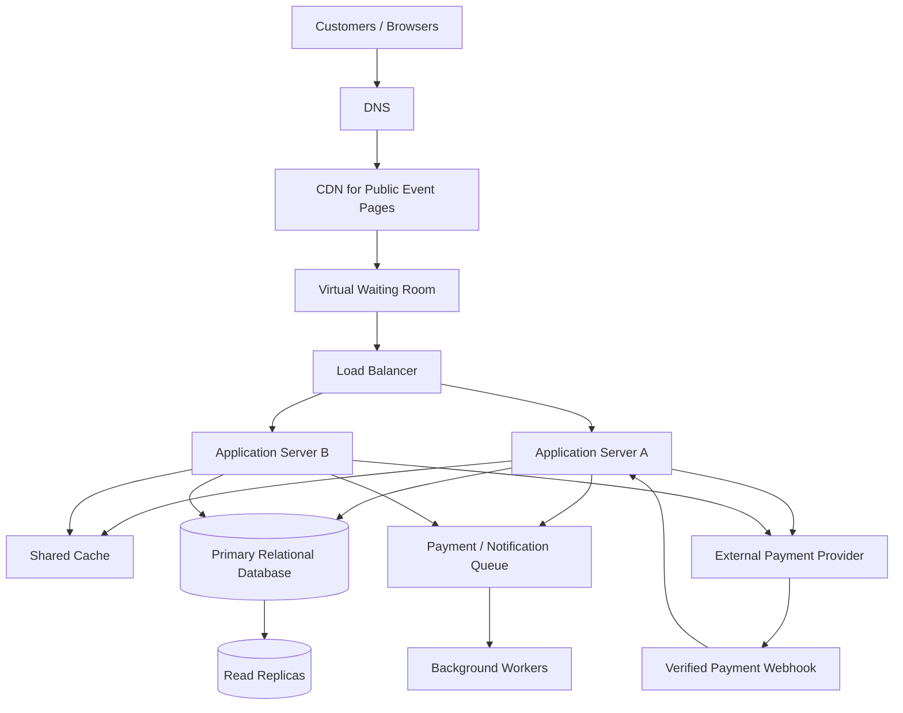

# TicketHub: Event Ticketing System Design

## 1. Context, Requirements and Goals

### Context

TicketHub is an online ticketing platform where users discover events, view available seats, reserve seats, pay for tickets, and access their purchased tickets. The system must support ordinary daily traffic as well as sudden traffic spikes when tickets for popular concerts go on sale.

The main design challenge is selling a limited number of seats fairly and reliably without allowing two customers to purchase the same seat.

### Functional requirements

1. Users can register, log in, and manage their accounts.
2. Users can browse upcoming events and view event details.
3. Users can view available, held, and sold seats for an event.
4. Users can temporarily hold available seats while completing checkout.
5. Users can pay for a valid order and receive confirmation.
6. Users can view their purchased tickets.
7. The system expires unpaid seat holds and releases the seats for other customers.

### Non-functional requirements

- **Speed:** Event pages should load quickly, and seat availability should normally respond within 200 ms, excluding external payment delays.
- **Correctness:** A seat must never be sold to two different customers.
- **Availability:** Target 99.9% monthly availability for browsing and ticketing services.
- **Fairness:** During a major sale, customers should enter through a controlled virtual waiting room rather than overwhelming the checkout service. Queue position should follow a clearly communicated policy, such as first-in-first-out after joining the sale queue.
- **Security:** Use HTTPS, authenticated sessions, authorization checks, rate limiting, and secure payment-provider integration.
- **Scalability:** The system should handle normal traffic and large bursts of concurrent requests.
- **Reliability:** Orders and confirmed payments must be recorded consistently, and failed or duplicated requests must not result in duplicate purchases.
- **Usability:** Customers should receive clear messages when seats are unavailable, holds expire, or payments fail.

### Goals and non-goals

**Goals:** Sell tickets reliably, prevent double-booking, provide a fair purchase process, and remain responsive during major sales.

**Non-goals for the first version:** Resale marketplaces, dynamic ticket pricing, international multi-region inventory writes, and complex event recommendations.

## 2. Capacity Estimates

The following calculations use the supplied assignment figures. They are planning estimates, not measured production results.

### Normal-day traffic

- Registered users: 2,000,000.
- Daily visitors: 50,000.
- Page views per visitor: 10.
- Total daily page views: 50,000 × 10 = **500,000 page views/day**.
- Average page views per second: 500,000 ÷ 86,400 ≈ **5.8 page views/second**.
- Tickets sold daily: 5,000.
- Average ticket sales: 5,000 ÷ 86,400 ≈ **0.058 tickets/second**, or about 3.5 tickets/minute.

Actual API request traffic will be higher than page views if each page makes several API calls. Traffic will also vary by time of day, so the average is not a safe peak-capacity target.

### Popular concert sale

The system must handle 200,000 people trying to buy 20,000 seats within the first 10 minutes.

- Average purchase attempts: 200,000 ÷ 600 = **about 333 people/second**.
- Available seats: 20,000.
- Maximum successful seat sales for this event: 20,000.
- Potential demand is 200,000 ÷ 20,000 = **10 times the available inventory**.
- To sell all 20,000 seats within 10 minutes, the system must complete about 20,000 ÷ 600 = **33 successful ticket sales/second** on average.

A short burst may be several times higher than the 333 attempts/second average. For initial planning, the system should be load-tested at approximately 3,300 purchase attempts/second, then capacity adjusted using test results.

### Comparison

Normal traffic is relatively predictable, while a popular sale creates a sudden concentration of requests for a small number of seats. The most important bottleneck is not simply page delivery; it is the concurrent seat-hold, order, and payment workflow.

To manage this difference, TicketHub will cache public event information, place customers in a virtual waiting room during major sales, rate-limit requests, and protect seat inventory with database transactions and constraints.

## 3. API Design

Base URL: `https://api.tickethub.example/v1`

All requests and responses use JSON unless otherwise stated. Authenticated endpoints require a valid access token. The examples show the proposed API contract, not a currently deployed service.

| Method and endpoint | Purpose | Success response |
|---|---|---|
| `GET /events` | Browse upcoming events, with pagination and filters | `200 OK` |
| `GET /events/{eventId}` | View event details | `200 OK` |
| `GET /events/{eventId}/seats` | View seat availability | `200 OK` |
| `POST /events/{eventId}/holds` | Temporarily hold selected seats | `201 Created` |
| `POST /orders` | Create an order from a valid seat hold | `201 Created` |
| `POST /orders/{orderId}/payments` | Initiate or confirm payment through a payment provider | `202 Accepted` |
| `GET /me/tickets` | List tickets belonging to the authenticated user | `200 OK` |
| `GET /orders/{orderId}` | Check order and payment status | `200 OK` |

### Example: Hold seats

Request: `POST /events/42/holds`

```json
{
  "seatIds": [501, 502],
  "idempotencyKey": "hold-unique-request-123"
}
```

Successful response: `201 Created`

```json
{
  "holdId": "hold-9001",
  "eventId": 42,
  "seatIds": [501, 502],
  "status": "ACTIVE",
  "expiresAt": "2026-11-01T12:10:00Z"
}
```

If either requested seat is unavailable, the server returns `409 Conflict` and does not partially hold the requested group of seats.

### Example: Create an order

Request: `POST /orders`

```json
{
  "holdId": "hold-9001",
  "idempotencyKey": "order-unique-request-456"
}
```

Successful response: `201 Created`

```json
{
  "orderId": "order-7001",
  "status": "PENDING_PAYMENT",
  "amount": 200000,
  "currency": "UGX"
}
```

The server calculates the price from trusted event and seat records. It does not trust a price supplied by the client.

### Error handling

- `400 Bad Request`: malformed input or invalid seat selection.
- `401 Unauthorized`: missing or invalid authentication.
- `403 Forbidden`: user is not allowed to perform the requested action.
- `404 Not Found`: event, seat, hold, or order does not exist or is not accessible.
- `409 Conflict`: a seat is already held or sold, or a request conflicts with the current state.
- `429 Too Many Requests`: the client has exceeded a rate limit.
- `500 Internal Server Error`: unexpected server failure.

Errors should use a consistent JSON structure, such as:

```json
{
  "error": {
    "code": "SEAT_UNAVAILABLE",
    "message": "One or more selected seats are no longer available."
  }
}
```

Payment callbacks must be authenticated and verified with the payment provider. Idempotency keys prevent repeated requests from creating duplicate orders or charging customers more than once.

## 4. Data Model

TicketHub will initially use a relational database such as PostgreSQL because ticket sales require transactions, unique constraints, and strong consistency for seat inventory.

### Tables and relationships

**users**
- `id`: primary key.
- `name`: customer's name.
- `email`: unique email address.
- `password_hash`: securely hashed password.
- `created_at`: account creation timestamp.

**events**
- `id`: primary key.
- `title`: event name.
- `venue`: event venue.
- `starts_at`: event start time.
- `status`: event status, such as scheduled or cancelled.

**seats**
- `id`: primary key.
- `event_id`: foreign key referencing `events.id`.
- `seat_label`: seat identifier within the event, such as A-12.
- `price`: ticket price.
- `status`: current state, such as AVAILABLE, HELD, or SOLD.
- `hold_expires_at`: expiry timestamp for an active hold.
- `held_by_user_id`: nullable foreign key referencing `users.id`.

**orders**
- `id`: primary key.
- `user_id`: foreign key referencing `users.id`.
- `status`: order state, such as PENDING_PAYMENT, PAID, EXPIRED, or CANCELLED.
- `total_amount`: amount due for the order.
- `currency`: payment currency.
- `idempotency_key`: unique key used to safely retry order creation.
- `created_at`: order creation timestamp.

**order_items**
- `id`: primary key.
- `order_id`: foreign key referencing `orders.id`.
- `seat_id`: foreign key referencing `seats.id`.
- `unit_price`: price captured when the order is created.

**payments**
- `id`: primary key.
- `order_id`: foreign key referencing `orders.id`.
- `provider_reference`: unique payment-provider transaction reference.
- `status`: payment state.
- `amount`: amount paid or attempted.
- `created_at`: payment record creation timestamp.

Relationships:

- One user can create many orders.
- One event has many seats.
- One order contains one or more order items.
- Each order item refers to one seat.
- An order can have multiple payment attempts, but a successful payment must be recorded idempotently.
- A seat belongs to one event, and its event/seat-label combination must be unique.

### Example SQL schema

```sql
CREATE TABLE users (
    id BIGINT GENERATED ALWAYS AS IDENTITY PRIMARY KEY,
    name VARCHAR(150) NOT NULL,
    email VARCHAR(255) NOT NULL UNIQUE,
    password_hash VARCHAR(255) NOT NULL,
    created_at TIMESTAMPTZ NOT NULL DEFAULT CURRENT_TIMESTAMP
);

CREATE TABLE events (
    id BIGINT GENERATED ALWAYS AS IDENTITY PRIMARY KEY,
    title VARCHAR(200) NOT NULL,
    venue VARCHAR(200) NOT NULL,
    starts_at TIMESTAMPTZ NOT NULL,
    status VARCHAR(20) NOT NULL DEFAULT 'SCHEDULED'
        CHECK (status IN ('SCHEDULED', 'CANCELLED', 'COMPLETED'))
);

CREATE TABLE seats (
    id BIGINT GENERATED ALWAYS AS IDENTITY PRIMARY KEY,
    event_id BIGINT NOT NULL REFERENCES events(id),
    seat_label VARCHAR(30) NOT NULL,
    price NUMERIC(12, 2) NOT NULL CHECK (price >= 0),
    status VARCHAR(20) NOT NULL DEFAULT 'AVAILABLE'
        CHECK (status IN ('AVAILABLE', 'HELD', 'SOLD')),
    hold_expires_at TIMESTAMPTZ,
    held_by_user_id BIGINT REFERENCES users(id),
    UNIQUE (event_id, seat_label),
    CHECK (
        (status = 'HELD' AND hold_expires_at IS NOT NULL
            AND held_by_user_id IS NOT NULL)
        OR
        (status <> 'HELD' AND hold_expires_at IS NULL
            AND held_by_user_id IS NULL)
    )
);

CREATE TABLE orders (
    id BIGINT GENERATED ALWAYS AS IDENTITY PRIMARY KEY,
    user_id BIGINT NOT NULL REFERENCES users(id),
    status VARCHAR(25) NOT NULL DEFAULT 'PENDING_PAYMENT'
        CHECK (status IN (
            'PENDING_PAYMENT', 'PAID', 'EXPIRED', 'CANCELLED'
        )),
    total_amount NUMERIC(12, 2) NOT NULL CHECK (total_amount >= 0),
    currency CHAR(3) NOT NULL DEFAULT 'UGX',
    idempotency_key VARCHAR(100) NOT NULL UNIQUE,
    created_at TIMESTAMPTZ NOT NULL DEFAULT CURRENT_TIMESTAMP
);

CREATE TABLE order_items (
    id BIGINT GENERATED ALWAYS AS IDENTITY PRIMARY KEY,
    order_id BIGINT NOT NULL REFERENCES orders(id),
    seat_id BIGINT NOT NULL REFERENCES seats(id),
    unit_price NUMERIC(12, 2) NOT NULL CHECK (unit_price >= 0),
    UNIQUE (seat_id)
);

CREATE TABLE payments (
    id BIGINT GENERATED ALWAYS AS IDENTITY PRIMARY KEY,
    order_id BIGINT NOT NULL REFERENCES orders(id),
    provider_reference VARCHAR(150) UNIQUE,
    status VARCHAR(20) NOT NULL
        CHECK (status IN ('PENDING', 'SUCCEEDED', 'FAILED', 'REFUNDED')),
    amount NUMERIC(12, 2) NOT NULL CHECK (amount >= 0),
    created_at TIMESTAMPTZ NOT NULL DEFAULT CURRENT_TIMESTAMP
);

CREATE INDEX idx_events_starts_at ON events (starts_at);
CREATE INDEX idx_seats_event_status ON seats (event_id, status);
CREATE INDEX idx_orders_user_created ON orders (user_id, created_at DESC);
```

The unique constraint on `order_items.seat_id` is an additional safeguard against assigning one seat to multiple orders. In a production system, cancelled or expired orders need a carefully designed rebooking process; a permanent historical order-item record must not accidentally prevent a legitimately released seat from being sold again. One solution is to enforce uniqueness on active seat allocations using a separate allocation table or a suitable partial unique index.

### Preventing two people from buying the same seat

A seat is not reserved merely because it appears available on a customer's screen. The authoritative decision happens in the database.

1. A customer requests a seat hold.
2. The application begins a database transaction and locks the relevant seat rows, for example using `SELECT ... FOR UPDATE`, in a consistent order.
3. It checks that each seat is available or that its previous hold has expired.
4. If all requested seats are eligible, the transaction marks them HELD, records the customer and expiry time, and creates the hold/order records.
5. The transaction commits. A concurrent customer attempting to hold the same seat must wait for the lock and then see that it is no longer available.
6. After successful payment, the system verifies that the hold is still valid and atomically marks the seat SOLD and the order PAID.
7. If payment fails or the hold expires, a controlled transaction releases the seat only if it is still associated with that expired hold.

The database transaction prevents simultaneous changes from racing, while constraints provide a second layer of protection. A conditional update can also be used:

```sql
UPDATE seats
SET status = 'HELD',
    held_by_user_id = 123,
    hold_expires_at = CURRENT_TIMESTAMP + INTERVAL '10 minutes'
WHERE id = 501
  AND status = 'AVAILABLE'
RETURNING id;
```

The application must check that exactly one row was returned. If no row was returned, the seat was not available for that operation.

For multiple seats, all seat updates and hold records must be handled in one transaction; if any seat cannot be held, the transaction rolls back. Expired holds must be released safely without overriding a newer hold. Payment processing occurs outside the database transaction because external payment calls may be slow; the application uses a short-lived hold, verified payment callbacks, idempotency, and a second transaction to finalize the sale.

## 5. High-Level Architecture

### Architecture diagram



### Components and their purposes

**1. Customers and browsers:** Display events, seats, checkout pages, and tickets. The browser provides a convenient interface but does not decide whether a seat is available or whether payment succeeded.

**2. DNS:** Resolves the TicketHub domain to the appropriate service entry point.

**3. CDN:** Caches public event descriptions, images, stylesheets, and scripts close to users. Personalized seat availability and account data are not placed in a public cache.

**4. Virtual waiting room:** Controls entry during a popular sale. It limits the number of customers admitted to the purchase flow at once and gives users a queue position under a published fairness policy. Queue tokens are signed or otherwise protected against tampering.

**5. Load balancer:** Distributes admitted requests across healthy application servers and removes unhealthy instances from service.

**6. Application servers:** Run multiple stateless API instances. They authenticate customers, validate requests, enforce authorization, manage holds, create orders, and coordinate payment confirmation. Stateless instances can be added horizontally during high traffic.

**7. Shared cache:** Holds frequently requested public event details and other suitable read-heavy data. Seat availability is short-lived and can become stale, so it must never be the authority for allocating seats. The database decides whether a hold or sale can succeed.

**8. Primary relational database:** Stores users, events, seat states, orders, order items, and payments. Transactions, row locks, unique constraints, and durable commits protect the correctness of ticket sales.

**9. Read replicas:** Handle suitable read-heavy queries, such as event listings and historical ticket views. Replication can lag, so seat allocation and payment finalization must use the primary database.

**10. Payment provider:** Processes payment details securely. TicketHub stores transaction references and statuses rather than raw card details. A verified webhook reports the payment result.

**11. Queue and background workers:** Process non-critical tasks such as confirmation emails, notifications, and reconciliation. Retries must be idempotent so a repeated job does not send duplicate confirmations or create a second sale.

### Handling a major sale

Before tickets go on sale, TicketHub can cache event details and warm relevant public data. At sale time, the virtual waiting room admits customers at a controlled rate, protecting the application and database from a sudden flood of checkout requests.

Browsing requests are spread across the CDN, cache, and read replicas. Seat holds and final sales are sent to the primary database, where transactions serialize conflicting seat allocations. Monitoring tracks queue length, request latency, errors, database locks, payment failures, and remaining inventory. If payment processing slows, the system limits new checkout admissions instead of accepting more concurrent work than it can safely complete.

The waiting room should be designed to preserve fairness and should communicate the queue policy clearly. It cannot guarantee that everyone will get a ticket when demand is ten times greater than supply.

## 6. Trade-offs, Risks and Open Questions

### Trade-off 1: Strong consistency versus read scalability

Using the primary database for every seat operation gives stronger correctness but limits the write throughput available from that database. Read replicas and caching improve browsing performance, but replicas can lag and caches can be stale. TicketHub therefore uses replicas for appropriate reads while keeping seat holds, final sales, and payment state changes on the primary database.

### Trade-off 2: Waiting room versus immediate access

A virtual waiting room reduces overload and provides a more controlled sale, but customers may wait before reaching the checkout page. The queue policy and estimated wait should be communicated clearly. A waiting room also requires protection against automated abuse and queue-token manipulation.

### Trade-off 3: Short holds versus customer convenience

Short holds release inventory quickly when customers abandon checkout, improving ticket availability. However, customers with slow connections or delayed payments may lose their seats. TicketHub should choose a reasonable hold duration, show a countdown, and define how delayed payment confirmations are reconciled without selling the same seat twice.

### Trade-off 4: Availability versus strict correctness

During a database or network failure, it may be tempting to accept sales without confirming current seat state. TicketHub must not do this. It is better to temporarily reject or delay purchases than to oversell seats and create conflicting orders.

### Risks and open questions

- Payment providers may send duplicate or delayed callbacks; payment updates must be idempotent and reconciled.
- Automated bots may attempt to bypass the queue or hold large numbers of seats; rate limits, bot detection, and per-account limits may be needed.
- The exact waiting-room admission rate should be determined through load testing.
- Backup restoration, database failover, and recovery from partial payment failures must be tested before launch.
- Business rules still need to define ticket cancellation, refunds, accessible seating, group bookings, and the treatment of payment confirmations received after a hold expires.

## Conclusion

TicketHub begins with a straightforward web application and relational database, then adds components to address specific problems: a CDN and cache reduce repeated reads, a waiting room controls sale-time bursts, multiple stateless application servers improve capacity, and database transactions and constraints protect scarce seat inventory. The most important rule is that every successful seat allocation must be decided atomically by the authoritative database, never by a browser or cache.
